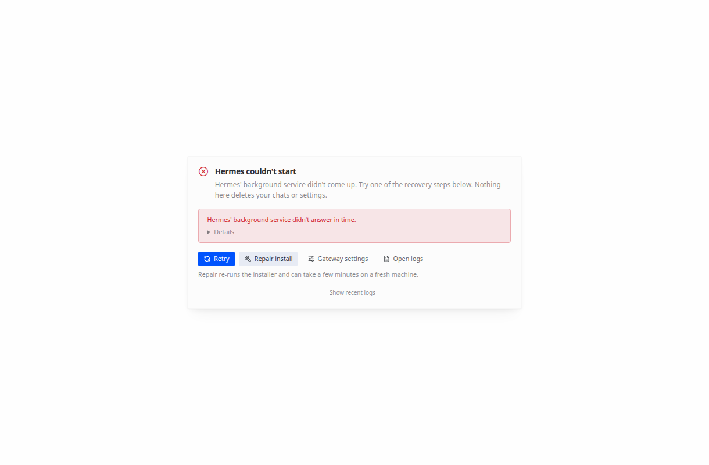
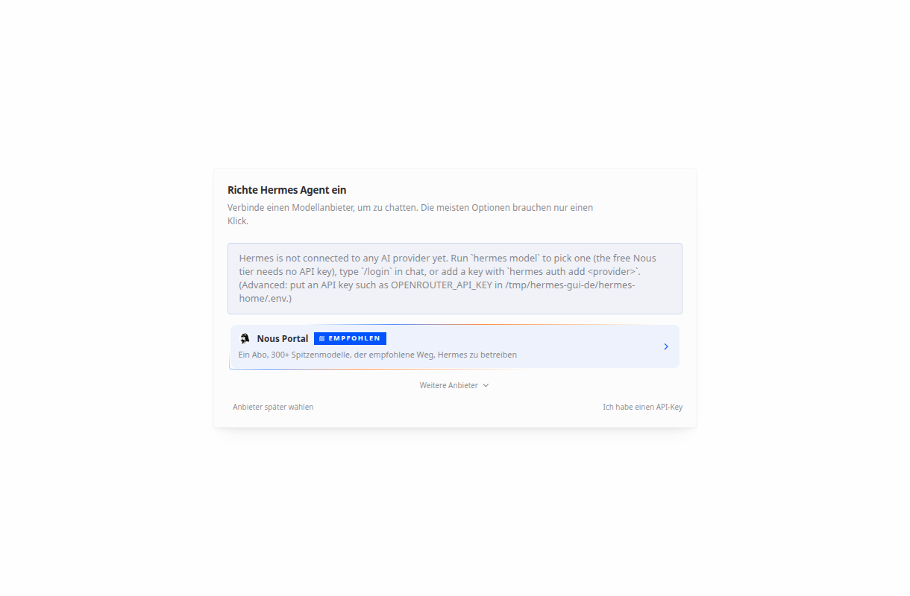
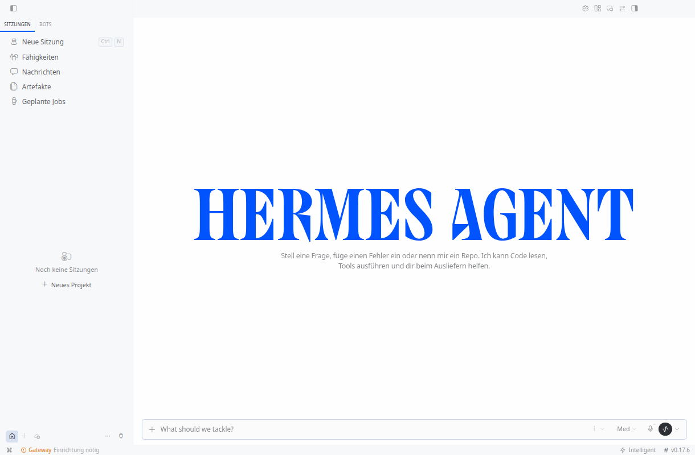
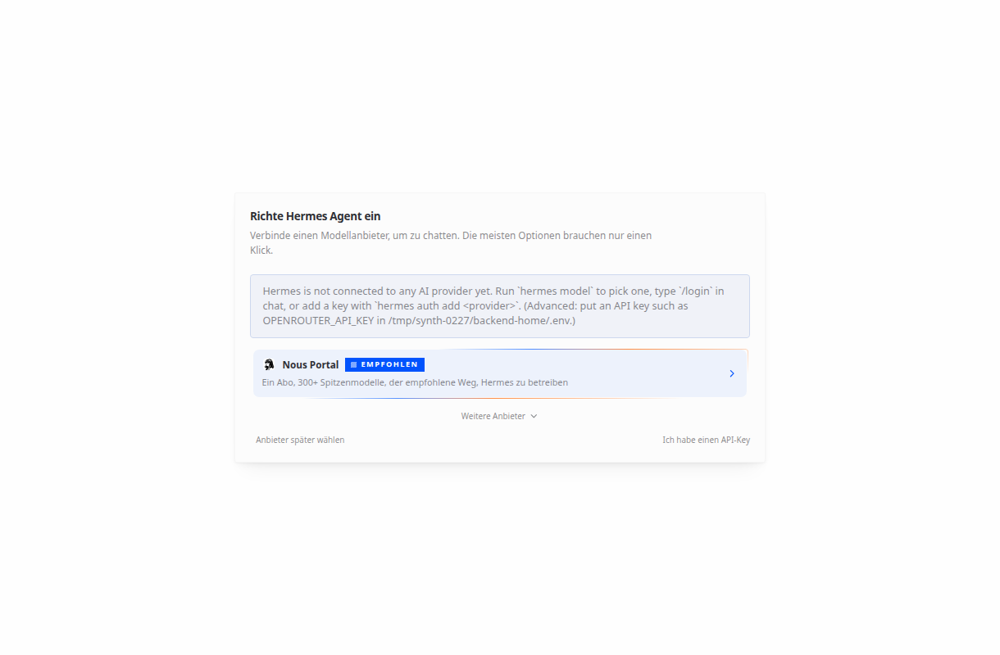

# Hermes Desktop 0.17.6 für Debian 13 (x86_64)

Dieses Dokument gehört zum Lokalisierungs-Repo. Es beschreibt das Linux-Paket
der **bestehenden** Desktop-App plus den **bestehenden** deutschen Patch.
Es ist kein neues Programm und kein Ersatz für die CLI.

Gebaut und headless geprüft am 08.11.2026 in einer Ubuntu-24.04-Umgebung.
Das ist **kein** Test auf dem Debian-13-Rechner und **kein** Start gegen
`/home/pascal/.hermes`.

## Was das Paket ist

| | |
|---|---|
| Desktop | **0.17.6** (`apps/desktop/package.json`) |
| Quellcommit | `6159bf4d87a32de72869e0b479606ddd2b9977a1` |
| Commit-Datum | 2026-09-20 09:00:16 -0700 |
| Betreff | `runner: drop the RLIMIT_DATA worker cap` |
| Electron | 40.10.2 |
| electron-builder | 26.15.3 |
| Node beim Build | 22.23.4 (Manifest: `^22.22.0 \|\| ^24.11.0 \|\| >=26.0.0`) |
| npm | 10.9.9 |
| Agent im selben Baum | **0.21.3**, Datum `2026.9.14` |
| Statusschema dieses Agenten | 30 (`hermes_state_common.SCHEMA_VERSION`) |
| Config-Schema dieses Agenten | 45 (`DEFAULT_CONFIG["_config_version"]`) |
| Locale-Patch | `0001-hermes-desktop-german-locale.patch` (Fassung 1.2.0 dieses Repos) |
| Install-Stempel | Commit wie oben, `dirty: true`, weil der Patch im Build-Baum uncommittet liegt |

Die Statuszeile des gebauten Fensters zeigt **v0.17.6**. Das ist die
Desktop-App. Die CLI **0.22.7** ist ein anderes, neueres Programm. Dieses
Paket ist auch nicht als identisch mit einer vorhandenen `Hermes.exe`
behauptet: die historische Windows-Notiz zeigt auf
`hermes-agent/apps/desktop/release/win-unpacked/Hermes.exe`, ohne eine
prüfbare Prüfsumme dieser Datei.

### Warum nicht 0.17.2 und nicht das aktuelle main

Die README-Fassung 1.1.0 nennt Desktop 0.17.2 und `d595e636c8`. Das stimmt
für jenen Tag. `apps/desktop/package.json` auf `d595e636c8` ist Version
**0.17.2**, Electron 40.10.2, electron-builder 26.15.3, Ziel
`dist:linux` = AppImage, deb, rpm. Die Datei, die der heutige Patch ändert
(`apps/desktop/src/app/capabilities/plugins/plugins-tab.tsx`), existiert auf
diesem Commit nicht.

`git apply --check` des heutigen Patches scheitert auf Upstream-`main`
`110afdd60e3098b86950963b06a792e261bd36a4` (08.11.2026, Desktop-Versionsfeld
dort `0.0.0`).

Dieselbe Patch-Vorlage passt auf 177 Commits am 20.09.2026, in denen alle
betroffenen Dateien bytegleich sind: von
`5a0fb0f38d2c3d088b286563931ebd95632fc5f6` bis
`6159bf4d87a32de72869e0b479606ddd2b9977a1`. Gebaut wurde der letzte. Deutsch
ist damit der Patch aus diesem Repo, nicht eine neue Übersetzung.

## Pakete

Der Artefaktspeicher nimmt einzelne Dateien bis knapp über 100 MB an und
lehnt etwa 120 MB ab. Die drei Pakete liegen deshalb in 80-MiB-Teilen.
Zusammensetzen steht in `ZUSAMMENSETZEN.txt` neben den Teilen.

Ganze Dateien:

| Datei | Bytes | SHA-256 |
|---|---:|---|
| `Hermes-0.17.6-linux-x86_64.AppImage` | 143849286 | `a81e5496d45d09f779fab9f85e89626a8f5ffcf6b2c37ef94e765e3cb3d004f4` |
| `Hermes-0.17.6-linux-amd64.deb` | 115661968 | `8356f5099ef35aeb919d0c72ea9386a700f265dce1c64e2ebd8bc7c544491736` |
| `Hermes-0.17.6-linux-x64-unpacked.tar.gz` | 156218897 | `3241d61417905a0e2b3b430ae3f8a8c6ece268f1f1abe018d05e7964c6479c11` |
| `linux-unpacked/Hermes` (auch in der AppImage) | 202984664 | `86be74e1f15b848f32112a994a381363a1f295ea50f0b2a761da86017f8b5109` |

Teile, jeweils `split -b 83886080 -d -a 2`:

| Teil | SHA-256 |
|---|---|
| `Hermes-0.17.6-linux-x86_64.AppImage.part-00` | `a7772f79f5624e6815169e7605364294b9a70e7cce2d522bb77842decf2a0af2` |
| `Hermes-0.17.6-linux-x86_64.AppImage.part-01` | `d2fe98f35180ca65b013c175b5b90808d1ed513980cd8b58f81ed313ffd80c1e` |
| `Hermes-0.17.6-linux-amd64.deb.part-00` | `6db397fea09593e74b5284518efadfa186650502f060e22e8dd2521d8e47bcbc` |
| `Hermes-0.17.6-linux-amd64.deb.part-01` | `a0596c60c4ae84c94334dd82b07b5777b87ddf59cc0db5f19e6761cc0046e2e5` |
| `Hermes-0.17.6-linux-x64-unpacked.tar.gz.part-00` | `f8fed96d6e09895d1783f7f3e701c3c164cf3193114110f7740caa9377071dbe` |
| `Hermes-0.17.6-linux-x64-unpacked.tar.gz.part-01` | `54d9150d361206269c918be0c451f65e4f40c92e5f3f1a03ca857ec26aef20b4` |

Die AppImage wurde mit `--appimage-extract` ausgepackt. Die SHA-256 von
`squashfs-root/Hermes` ist gleich der von `linux-unpacked/Hermes`.

Bevorzugt für einen Start ohne root: die AppImage oder das entpackte Archiv.
Das deb installiert nach `/opt/Hermes` und legt `/usr/bin/Hermes` an. Das
braucht root. `postinst` setzt `chrome-sandbox` nur dann setuid, wenn
User-Namespaces fehlen, und installiert ein AppArmor-Profil, wenn AppArmor
das mitgelieferte Profil akzeptiert.

## Laufzeitabhängigkeiten

`ldd` auf dem Hermes-Binary dieser Ubuntu-24.04-Umgebung meldete keine
fehlende Bibliothek. `readelf -d` verlangt unter anderem:

`libgtk-3.so.0`, `libnss3.so`, `libnspr4.so`, `libglib-2.0.so.0`,
`libgio-2.0.so.0`, `libgobject-2.0.so.0`, `libatk-1.0.so.0`,
`libatk-bridge-2.0.so.0`, `libatspi.so.0`, `libcups.so.2`, `libcairo.so.2`,
`libpango-1.0.so.0`, `libX11.so.6`, `libXcomposite.so.1`, `libXdamage.so.1`,
`libXext.so.6`, `libXfixes.so.3`, `libXrandr.so.2`, `libxcb.so.1`,
`libxkbcommon.so.0`, `libgbm.so.1`, `libexpat.so.1`, `libudev.so.1`,
`libasound.so.2`, `libdbus-1.so.3`, `libdrm` indirekt über GBM.

Das deb deklariert:

```
Depends: libgtk-3-0, libnotify4, libnss3, libxss1, libxtst6, xdg-utils,
         libatspi2.0-0, libuuid1, libsecret-1-0
Recommends: libappindicator3-1
```

`libasound.so.2` steht in der NEEDED-Liste des Binaries und fehlt in
`Depends`. Auf Ubuntu 24.04 liefert es `libasound2t64`. Auf Debian 13 heißt
das Paket ebenfalls `libasound2t64`. Wenn der dynamische Linker auf dem
Rechner `libasound.so.2` oder `libgbm.so.1` vermisst, diese Pakete nachziehen.
Die t64-Namen von Debian 13 stellen die alten Sonames bereit; ob
`apt install ./Hermes-….deb` die transitional-Namen `libgtk-3-0` und
`libatspi2.0-0` auflöst, ist hier nicht auf Debian 13 ausgeführt worden.
`libappindicator3-1` ist nur Recommends.

Versionierte glibc-Symbole des Hauptbinaries reichen bis `GLIBC_2.25`.
Gebaut bzw. gelinkt wurde gegen glibc 2.39 (Ubuntu 24.04). Debian 13 hat eine
neuere glibc. Das Binary verlangt kein neueres glibc als die Build-Maschine.

Ohne FUSE startet die AppImage so:

```bash
./Hermes-0.17.6-linux-x86_64.AppImage --appimage-extract-and-run
```

In dieser Umgebung waren User-Namespaces benutzbar (`unshare --user true`).
Das entpackte Binary startete **ohne** `--no-sandbox`. Ein fehlender
Session-Bus (DBus-Fehler im Log) hat das Fenster nicht verhindert. Debian 13
kann unprivilegierte User-Namespaces per AppArmor sperren. Dann endet ein
Start ohne root oft sofort mit einem Sandbox-Fehler. Das deb-`postinst`
fällt in dem Fall auf ein setuid-`chrome-sandbox` zurück. Das ist eine
Eigenschaft des Zielrechners, kein Ersatzbeleg aus dieser Umgebung.

Die App bringt Python nicht mit. Sie sucht ein vorhandenes `hermes` auf
`PATH` oder `HERMES_DESKTOP_HERMES`. Fehlt beides, zeigt sie die
Ersteinrichtung und installiert erst nach einer ausdrücklichen Wahl nach
`$HERMES_HOME/hermes-agent`.

## Deutsch

Der Patch ist vollständig im Paket: im gebauten Renderer liegt
`resources/app.asar.unpacked/dist/assets/i18n-DI9CTScC.js` mit
`Wie soll ich dich nennen` und den übrigen deutschen Katalogtexten.
`npx vitest run src/i18n`: 34 bestanden, darunter `normalizeLocale('de')`,
`de-DE`, `de_AT`, `Deutsch`.

Zwei gemessene Läufe, beide mit `LANG=de_DE.UTF-8`:

1. **Ohne Backend.** `app.getLocale()` liefert `de` (`getMachineProfile`).
   Die Oberfläche bleibt Englisch. `src/i18n/context.tsx` setzt bei
   fehlgeschlagenem `getConfig()` ausdrücklich `DEFAULT_LOCALE` (`en`) und
   wiederholt den Versuch. Solange kein Backend `/api/config` beantwortet,
   erscheint Deutsch nicht. Das erste Bild ist dieser Zustand, danach der
   Timeout-Dialog, weil kein Agent geantwortet hat.

   

2. **Mit dem Agenten 0.21.3 aus demselben Commit** und einer Probe-Config
   `display.language: de`, `_config_version: 45`. `document.documentElement.lang`
   ist `de`. Sichtbarer Text aus dem DOM, nicht aus der Bildbeschreibung:
   `SITZUNGEN`, `Neue Sitzung`, `Fähigkeiten`, `Nachrichten`, `Artefakte`,
   `Geplante Jobs`, `Noch keine Sitzungen`, `Neues Projekt`,
   `Stell eine Frage, füge einen Fehler ein oder nenn mir ein Repo.`,
   `Richte Hermes Agent ein`, `Einrichtung nötig`, `v0.17.6`.
   Der Tab `BOTS` ist die Großschreibung von `Bots`. Die deutsche
   Plugin-Zeile `pane.title` ist ebenfalls `Bots`, daran ist die Sprache
   nicht zu erkennen. Ein Satz des **Agenten** im Einrichtungsdialog blieb
   Englisch (`Hermes is not connected to any AI provider yet. …`). Das ist
   Backend-Text, kein fehlender Desktop-Schlüssel.

   

   

Es wurde kein Modell verbunden, kein Login ausgeführt und kein Prompt
gesendet. Der Klick im Test war `Anbieter später wählen`, nur im Probe-Home.

## HERMES_HOME — kein gemeinsamer Start mit dem bestehenden Bestand

Linux-Voreinstellung in `resolveHermesHome()` (`apps/desktop/electron/main.ts`):
`~/.hermes`, sofern `HERMES_HOME` nicht gesetzt ist. Liegt
`HERMES_DESKTOP_USER_DATA_DIR`, und **kein** `HERMES_HOME`, hängt das Home
unter `<userData>/hermes-home`. Electron-Zustand (Fenster, Verbindungen)
liegt sonst in `~/.config/Hermes`.

Ein Start schreibt sofort `$HERMES_HOME/logs/desktop.log`, auch wenn noch
kein Backend läuft.

Findet die App ein `hermes` auf `PATH`, dessen `--version` gelingt, startet
sie es **ohne Rückfrage** als `hermes serve --host 127.0.0.1 --port 0` und
übergibt `HERMES_HOME`. Auf dem Rechner mit CLI 0.22.7 wäre das diese CLI.
Diese Kombination ist **nicht** geprüft. `HERMES_DESKTOP_IGNORE_EXISTING=1`
überspringt vorhandene CLIs und zeigt die Ersteinrichtung. `Install Hermes
locally` würde dann den im Paket verstempelten Commit nach
`$HERMES_HOME/hermes-agent` holen.

Gemessen an Agent 0.21.3, nur in Wegwerfverzeichnissen:

- Frisches Home plus Backend: `state.db` mit Schema **30**, dazu
  `shared-state.db`, `projects.db`, `cron/`, `SOUL.md`, ein Skill-Baum,
  Caches, `install_id`, `.update_check`. Die Probe-`config.yaml` mit
  `_config_version: 45` und `display.language: de` blieb bytegleich
  (`4d923d4b0bc57e9ac49c10692a5cbf1a32f56608fa238f542713f9fadba68d86`).
- Eine Datenbank, deren `schema_version` auf 99 gesetzt war, blieb nach
  erneutem Öffnen bei **99**. `state_meta.fts_storage_version` wurde dabei
  auf `3` geschrieben. Die Versionszahl wird nicht heruntergesetzt
  (`UPDATE` nur bei `current_version < SCHEMA_VERSION`). Die Datei ändert
  sich trotzdem.
- `migrate_config()` bei `_config_version: 99` (dieser Code kennt nur bis 45)
  lässt `config.yaml` unverändert und legt in dem Home trotzdem `SOUL.md`,
  `cache/schema_columns.json` und
  `backups/config/config.yaml.good-…` an.

Es gibt keinen Lesemodus. Ein Start gegen `/home/pascal/.hermes` würde
mindestens das Log schreiben und, sobald die CLI 0.22.7 oder dieser Agent
0.21.3 daran hängt, die Zustandsdateien anfassen. Schema 30 gegen einen
neueren Bestand der CLI 0.22.7 ist kein sicheres Nebeneinander. **Nicht
starten**, bis der Probe-Lauf unten auf dem echten Bildschirm geprüft ist
und ausdrücklich entschieden wird, das echte Home weiter nicht zu verwenden.

`.update_check` im Probe-Home nannte `head`
`6159bf4d87a32de72869e0b479606ddd2b9977a1` und ein anderes Ziel-Commit. Es
wurde kein `hermes update` ausgeführt. Der Prozess wurde danach beendet.

System-Python 3.12.3 in der Build-Umgebung hat SQLite 3.45.1. Dieser Agent
warnt dann und nimmt `journal_mode=DELETE` statt WAL. Das betrifft den
Python-Interpreter, den das Backend wirklich benutzt, nicht das
Electron-Binary.

## Leeres Home und die schon installierte Laufzeit

`hermes` auf `PATH` ist der Store-Interpreter. Die Abhängigkeitengeneration
steht in `<HERMES_HOME>/installs/<install_key>/facts.json`
(`pm.environments.dependency_home_root`, Schlüssel = die ersten 16 Hexzeichen
von SHA-256 des aufgelösten Checkout-Pfads). Ein leeres `HERMES_HOME` hat
diesen Datensatz nicht. `hermes --version` ist zusätzlich ein Metadaten-Flag
(`hermes_cli.venv_sync._METADATA_FLAGS`) und überspringt den Borrow-Sync.
Der Store-Interpreter hat selbst keine Pakete und endet mit Exit 1:

`hermes: no dependency environment is committed for this install; run hermes pm repair`

Das ist kein allgemeiner Defekt der CLI und kein Grund für `hermes pm repair`
am Produktions-Home.

Der öffentliche Einstieg, der die schon gebaute Generation behält, ist deren
eigener Interpreter:

`"<facts packages.venv.environment>/bin/python" -B -m hermes_cli.main`

`hermes_cli.main:main` ist der Konsolenskript-Einstieg, und `main.py` ist als
Modul startbar. Ein venv-Interpreter (`sys.prefix != sys.base_prefix`) behält
die Pakete, mit denen er gebaut wurde
(`pm.environments._require_own_dependencies`). `HERMES_HOME` bleibt dabei nur
das Datenverzeichnis. `HERMES_DISABLE_LAZY_INSTALLS=1` ist der dokumentierte
Schalter für Proben, der Nachinstallationen ablehnt
(`website/docs/reference/environment-variables.md`). Er wird nicht in `.env`
geschrieben.

`--print-runtime-command` liefert den Store-Interpreter und damit genau den
Einstieg, der am leeren Home scheitert. Die Generation steht im Datensatz
`facts.json`, nicht in diesem Kommando.

Auf dem Rechner wurde genau das geprüft, ohne dieses Repo: `--version` und
`serve --help` mit Exit 0, CLI 0.22.7, Commit `b200f5bc60e3`, Python 3.14.9,
leere `HOME` / `HERMES_HOME` / XDG, Code und Laufzeit nur lesend. Die
Fingerprint-Pfade dieser Installation gehören nicht ins Repo. Das Skript liest
sie aus `facts.json`. Hier gegen denselben Commit, mit dem venv dieser
Umgebung (Python 3.14.10, nicht die PC-Binary): dieselben beiden Aufrufe
Exit 0. `serve --help` nennt `--skip-build` und `--isolated`. `--skip-build`
überspringt den Web-UI-Build. `--isolated` startet bei einem benannten Profil
einen eigenen Server; es verlegt `HERMES_HOME` nicht. Die Trennung vom
Produktions-Home ist allein das gesetzte `HERMES_HOME`.

`--version` über diesen Einstieg legt im **Probe**-Home dennoch Log, `SOUL.md`
und `installs/<key>/bootstrap/` an. Das Produktions-Home wird dafür nicht
gebraucht. Kein `config.yaml` und kein `state.db` in dieser Kurzprobe.

## Bereitschaft

Desktop 0.17.6 fragt den Backend-Gateway nach `setup.status` und
`setup.runtime_check` (`src/lib/runtime-readiness.ts`). Beide Methoden gibt
es in CLI 0.22.7 (`tui_gateway/methods_config.py`). Auf einem leeren Home,
ohne Anmeldung, antwortet 0.22.7 in diesem Checkout in unter einer Sekunde:

- `setup.status`: `provider_configured: false`
- `setup.runtime_check`: `ok: false` und der Satz, dass kein Anbieter
  verbunden ist

`interpretRuntimeReadiness` liest `ok`. `false` ist `needs_setup`, also die
deutsche Anbieter-Einrichtung, nicht ein hängender Vertrag. Ein frisches
Profil hat keine alte Historie und keinen Anbieter. Das ist der fertige
Zustand, bis jemand selbst einen Anbieter einträgt. Login, Portal und
Inferenz werden dafür nicht aufgerufen.

Ein Feld hat sich umbenannt: 0.17.6 liest `setup.runtime_check.free_tier`,
0.22.7 schreibt im Erfolgsfall `free_tier_route`. Fehlt der Boolesche Wert,
bleibt er für den Client unbekannt. `ok` entscheidet trotzdem. Unter einem
lebenden `hermes serve` kann die erste `setup.status` bis etwa 12 Sekunden
auf den Boot-Datensatz warten und einmal `readiness check still in progress`
antworten. Der Client fragt danach erneut. Das ist keine andere Schnittstelle.

## Anbindung an CLI 0.22.7 ohne Autostart

Gemessen am 08.11.2026 nur in frischen Verzeichnissen unter `/tmp/synth-0227`.
Kein Produktions-Home, kein Login, kein Portal-Klick, kein Modell.

Der Bezugsstand der CLI ist das Git-Tag `v0.22.7`, Commit
`b200f5bc60e31588ba2cb60e288029c4a54ba5fa`. `hermes --version` dazu:
`Hermes Agent v0.22.7 (2026.9.24)`, Python 3.14.10. Das Desktop-Paket an
demselben Tag trägt in `package.json` die Versionsnummer `0.0.0`; die
Identität der CLI kommt aus dem Install-Stempel bzw. dem Tag. Statusschema
32, Config-Schema 52. Electron dort 44.9.3, Node `>=26`, Linux-Ziel nur
AppImage. Der deutsche Patch von 0.17.6 lässt sich dort nicht anwenden
(`git apply --check` bricht ab). Ein zweites Paket ist daraus nicht gebaut
worden: die vorhandene App 0.17.6 spricht den dokumentierten Serve-Endpunkt
an, und die v1-Artefakte bleiben unverändert.

Dokumentierter Endpunkt, beide Seiten:

- Backend: `hermes serve --host 127.0.0.1 --port 9127` mit
  `HERMES_DASHBOARD_SESSION_TOKEN`. Das ist der kopflose Server, den die
  Hilfe als Gateway für die Desktop-App beschreibt. Öffentliches
  `GET /api/status` lieferte `version: 0.22.7`, `config_version: 52`,
  `latest_config_version: 52`, `auth_required: false`,
  `auth_providers: ["session-token"]`.
- Desktop: `HERMES_DESKTOP_REMOTE_URL` und `HERMES_DESKTOP_REMOTE_TOKEN`
  müssen **beide** gesetzt sein (`desktop-remote-route.ts` bricht sonst ab).
  `runPrimaryBackendStartup` löst die Remote-Verbindung auf, **bevor** ein
  lokales `hermes serve` erzeugt wird. Header der REST-Aufrufe:
  `X-Hermes-Session-Token`.

Ablauf der Messung: Serve mit Python 3.14 und leerem `HERMES_HOME`. Danach
Desktop 0.17.6 mit einem **anderen** leeren `HERMES_HOME`,
`HERMES_DESKTOP_IGNORE_EXISTING=1`, URL `http://127.0.0.1:9127` und dem
Token. Es blieb genau ein `hermes serve` (PID unverändert). Das Log sagt
`Connecting to remote Hermes backend` und `Remote Hermes backend is ready`,
nicht `Starting Hermes backend`.

Zustand danach:

| Datei im Backend-Home | Vorher | Nachher |
|---|---|---|
| `config.yaml` | fehlt | fehlt |
| `shared-state.db` | SHA-256 `95d67f72…aa74` | unverändert |
| `SOUL.md` | SHA-256 `36c1f5a2…506f` | unverändert |
| `state.db` | fehlt | neu, `schema_version` **32**, 0 Sessions |

Schema 32 ist das Schema von CLI 0.22.7, nicht 30. Die Datei legt der
0.22.7-Prozess an, wenn die App Sitzungen abfragt. Zusätzlich entstanden
`skills/.curator_state` und `state/dashboard_clients.heartbeat`. Das
Desktop-Home enthielt nur `logs/desktop.log`. Kein `hermes-agent`-Checkout,
kein zweites `state.db`.

Das Fenster war deutsch (`lang=de`): Sitzungen, Neue Sitzung, Fähigkeiten,
Nachrichten, Artefakte, Geplante Jobs. Die Statuszeile zeigte
`Client v0.17.6` und `Backend v0.22.7 (aktualisieren)`.



Ein Update-Hinweis
(`Update bereit`) lag im DOM. Er wurde nicht angeklickt. `Jetzt aktualisieren`
würde das entfernte Backend das Update ausführen lassen
(`availableBodyBackend` / `applyingBodyBackend`). Das ist der Weg, auf dem
ein Klick das Checkout verändern kann. Nicht klicken.

Der Einrichtungsdialog (`Richte Hermes Agent ein`, Nous Portal) erschien,
weil das leere Probe-Home keinen Modellanbieter hat. Nous Portal, Login und
API-Key wurden nicht benutzt. Ein Satz des Backends blieb englisch.

Damit ist die Paarung für einen **leeren** Probe-Lauf tragfähig, wenn URL
und Token gesetzt sind und niemand das Update auslöst. Sie ist kein Beleg,
dass die App das Produktions-Home `/home/pascal/.hermes` öffnen darf. Der
erste Lauf auf dem Rechner bleibt bei leeren Verzeichnissen. Auch der
Remote-Modus liest `HERMES_HOME` der Desktop-Prozesses
(`migrateActiveProfileIfMissing`, `logs/desktop.log`). Deshalb bekommt die
App ein eigenes Probe-Home, nicht das Home des Backends und nicht
`~/.hermes`.

Ein Desktop-Neubau passend zu 0.22.7 ist nicht erfolgt. Er brauchte Node
`>=26` und Electron 44.9.3, und der vorhandene Patch passt nicht. Solange
der Probe-Lauf über den Serve-Endpunkt das Fenster zeigt, bleibt v1 das
Paket.

## Dauerhafte Installation

Kein root, kein `--no-sandbox`, kein Eintrag in `PATH`, kein Schreibzugriff
auf `~/.hermes`. Die AppImage wird nach
`$XDG_DATA_HOME/hermes-desktop/` kopiert (Voreinstellung
`~/.local/share/hermes-desktop/`). Der Starter heißt **Hermes Desktop** und
liegt unter `$XDG_DATA_HOME/applications/hermes-desktop.desktop`. Ein
vorhandener Terminal-Starter bleibt liegen.

```bash
werkzeug/hermes-desktop-installieren.sh /pfad/zu/Hermes-0.17.6-linux-x86_64.AppImage
```

Danach steht Hermes Desktop im Anwendungsmenü. Der Starter
`werkzeug/hermes-desktop-starten.sh` (installiert als `bin/hermes-desktop`):

- liest den Interpreter nur aus `facts.json` (`packages.venv.environment`)
- startet `python -B -m hermes_cli.main serve --host 127.0.0.1 --port 0 --skip-build --isolated`
- setzt `HERMES_DISABLE_LAZY_INSTALLS=1`
- legt Backend-Home und Desktop-Home frisch unter dem Installationsverzeichnis an, mit `LESE-MICH.txt`
- erzeugt ein Sitzungs-Token pro Lauf, nur in der Prozessumgebung, nicht in den Logs
- wartet auf `HERMES_BACKEND_READY`, dann startet die AppImage ohne `--no-sandbox`
- hält eine Sperre; ein zweiter Klick versucht nur, das Fenster zu fokussieren
- beendet beim Schließen nur das Backend, dessen `HERMES_HOME` dieses Backend-Home ist
- bricht sichtbar ab, wenn `unshare --user` fehlschlägt, und nennt `logs/launcher.log`

Nicht unterstützt: `hermes` auf `PATH` mit fremdem `HERMES_HOME`,
`hermes pm repair`, `hermes update` aus dieser App, `--no-sandbox`,
`--print-runtime-command` als Laufzeit des leeren Homes, ein Start ohne
User-Namespaces, und die Annahme, das frische Home enthalte die alten
Sitzungen.

Prüfung: `werkzeug/hermes-desktop-launcher.test.sh`.

| Datei | SHA-256 |
|---|---|
| `werkzeug/hermes-desktop-starten.sh` | `baa51d8f1f73b9dd44818c031ac0dd4e6b8f8bd9ec9606c9ec4fdacdb70753c6` |
| `werkzeug/hermes-desktop-installieren.sh` | `620963578aa9bb4db2d0e16eafff754bbe27e33903d69faba09b905e533782b0` |
| `werkzeug/hermes-desktop-launcher.test.sh` | `8dd5beb3b512be5c3e11badf23712aed4d5d2e7fc542a9d0a27521bbe5f91ece` |
| `installer/hermes-desktop-icon.png` | `277c2ed7bed8d9a3c3a09280dfbafaf6546c23a41443491637abe12259684394` |

## Erster Start auf dem Debian-Rechner

Nur leere Probe-Verzeichnisse. Nicht `/home/pascal/.hermes`. Die Skripte
brechen ab, wenn der Pfad dieses Home oder `$HOME/.hermes` ist. Sie ändern
`PATH` nicht und installieren nichts.

Zuerst das Backend. Das Skript ruft nicht `hermes` auf `PATH` auf. Es liest
nur `facts.json` im Install-Datenwurzel (Voreinstellung `$HOME/.hermes`) und
startet den dort genannten venv-Interpreter. Checkout und Datenwurzel bleiben
unbeschrieben, soweit der Prozess sie nicht selbst anfasst; der Integrator
hat sie zusätzlich nur lesend gebunden.

```bash
PROBE=/home/pascal/hermes-desktop-probe
HERMES_DASHBOARD_SESSION_TOKEN='ein-synthetisches-token' \
  werkzeug/linux_cli_probe_serve.sh "$PROBE/backend-home"
```

Danach die App 0.17.6. Ohne FUSE `HERMES_APPIMAGE_EXTRACT=1` setzen. Das
Skript prüft `unshare --user` und hängt **nicht** `--no-sandbox` an.

```bash
HERMES_DESKTOP_REMOTE_URL=http://127.0.0.1:9127 \
HERMES_DESKTOP_REMOTE_TOKEN='ein-synthetisches-token' \
HERMES_APPIMAGE_EXTRACT=1 \
LANG=de_DE.UTF-8 \
  werkzeug/linux_desktop_starten.sh "$PROBE" \
  ./Hermes-0.17.6-linux-x86_64.AppImage
```

Die App schreibt nach `$PROBE/desktop-home` und `$PROBE/userdata`. Die CLI
schreibt nach `$PROBE/backend-home`. Keines von beiden ist `~/.hermes`.

Erwartung aus der Messung: Fenster der echten App, deutsch, Statuszeile
`Client v0.17.6` und `Backend v0.22.7`, genau ein `hermes serve`. Nicht
anklicken: `Jetzt aktualisieren`, `Install Hermes locally`, `Repair install`,
`Nous Portal`, Login, `Ich habe einen API-Key`.

Wenn `unshare --user true` fehlschlägt, nicht mit `--no-sandbox` wiederholen.
Dann bleibt der Sandbox-Fehler der Befund. Das deb ist der Kandidat, dessen
`postinst` `chrome-sandbox` setuid setzt, und das braucht root. Debian 13
ist damit nicht als lauffähig belegt. Ein fehlender Session-Bus (DBus-Fehler)
hat in der Ubuntu-Messung das Fenster nicht verhindert.

## Build nachvollziehen

`werkzeug/linux_desktop_bauen.sh` klont Upstream **außerhalb** dieses Repos,
prüft den Commit, spielt den Patch ein und baut AppImage, deb und das
entpackte Verzeichnis. Der Upstream-Baum wird hier nicht eingecheckt.

Gegen den gebauten Baum, vor dem Paketieren: `npx tsc --noEmit` ohne Fehler,
`npx vitest run src/i18n` 34/34. `npm run build` und
`node scripts/run-electron-builder.mjs --linux AppImage deb` mit
`NODE_OPTIONS=--max-old-space-size=8192`. Das npm-Skript `builder` setzt
16384 und ist auf einer 16-GB-Maschine der falsche Hebel; das Ergebnis ist
dasselbe electron-builder-Skript.
